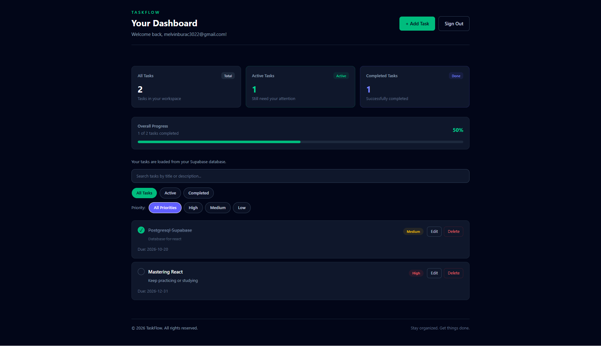

# TaskFlow — Task Management App

A modern, responsive task management application built with **React, Tailwind CSS, and Supabase**. TaskFlow helps users organize their work, manage priorities, track progress, and keep their tasks in one place.

<p align="center">
  <a href="https://taskflow-beige-two.vercel.app/">
    <strong>🚀 Live Demo</strong>
  </a>
  &nbsp; · &nbsp;
  <a href="https://github.com/Melvin-12143031/taskflow">
    <strong>📂 GitHub Repository</strong>
  </a>
</p>

---

## 📸 Preview

<p align="center">
  
</p>

---

## ✨ Features

- **User Authentication** — Register an account, log in, and access protected areas of the application.
- **Task Management** — Create, view, edit, and delete tasks.
- **Task Status & Priorities** — Organize tasks by their current status and priority level.
- **Task Filtering** — Filter tasks by status and priority to find what matters.
- **Due Dates** — Set due dates to organize upcoming work.
- **Database Persistence** — Store task data using Supabase.
- **Form Validation & Feedback** — Receive feedback when submitting forms and when operations succeed or fail.
- **Loading States** — Get clear feedback while asynchronous operations are processing.
- **Responsive Design** — Use the application across desktop, tablet, and mobile screens.
- **Protected Dashboard** — Restrict dashboard access to authenticated users.
- **Persistent Data** — Keep tasks saved in the database when revisiting the application.
- **Refresh-Friendly Routing** — Support direct access to application routes on the deployed site.

## 🛠️ Tech Stack

| Technology | Purpose |
|---|---|
| React | Component-based user interface |
| Vite | Development server and production build |
| Tailwind CSS | Responsive styling and layout |
| Supabase | Authentication and database |
| JavaScript (ES6+) | Application logic |
| ESLint | Code quality and linting |
| Git & GitHub | Version control and source code hosting |
| Vercel | Deployment and hosting |

## 🚀 Live Demo

**Try TaskFlow:** [https://taskflow-beige-two.vercel.app/](https://taskflow-beige-two.vercel.app/)

You can explore the interface and register an account to test its authenticated features.

## 💻 Getting Started

Follow these instructions to run TaskFlow locally.

### Prerequisites

- [Node.js](https://nodejs.org/) and npm
- A [Supabase](https://supabase.com/) account and project

### 1. Clone the repository

```bash
git clone https://github.com/Melvin-12143031/taskflow.git
cd taskflow
```

### 2. Install dependencies

```bash
npm install
```

### 3. Configure environment variables

Create a `.env.local` file in the project root and add your Supabase project credentials:

```env
VITE_SUPABASE_URL=your_supabase_project_url
VITE_SUPABASE_PUBLISHABLE_KEY=your_supabase_publishable_key
```

Replace the placeholder values with your own Supabase project URL and publishable key.

**Security:** Never commit environment files or expose Supabase secret or service-role keys in client-side code. Configure appropriate Row Level Security (RLS) policies to protect user data.

### 4. Configure Supabase

Set up the database table and authentication settings required by the application.

Ensure that Row Level Security policies restrict each authenticated user to accessing only their own tasks.

### 5. Start the development server

```bash
npm run dev
```

Open the local URL displayed in your terminal.

## 🧪 Code Quality

Run ESLint to check for code issues:

```bash
npm run lint
```

Create a production build:

```bash
npm run build
```

Preview the production build locally:

```bash
npm run preview
```

## 📁 Project Structure

```text
taskflow/
├── public/
│   ├── screenshot.png
│   └── taskflow.svg
├── src/
│   ├── components/
│   │   ├── ConfirmDialog.jsx
│   │   ├── Footer.jsx
│   │   ├── ProtectedRoute.jsx
│   │   └── TaskForm.jsx
│   ├── contexts/
│   │   ├── AuthContext.jsx
│   │   ├── auth-context.js
│   │   └── useAuth.js
│   ├── data/
│   │   ├── priorities.json
│   │   └── statuses.json
│   ├── lib/
│   │   ├── supabase.js
│   │   └── taskService.js
│   ├── pages/
│   │   ├── Dashboard.jsx
│   │   ├── Login.jsx
│   │   └── Register.jsx
│   ├── App.jsx
│   ├── App.css
│   ├── index.css
│   └── main.jsx
├── .gitignore
├── index.html
├── package.json
├── vercel.json
└── vite.config.js
```

## 🎯 What I Learned

Building TaskFlow provided hands-on practice with:

- Building reusable React components.
- Managing component state and asynchronous operations.
- Implementing authentication and protected routes.
- Integrating a frontend application with a hosted database.
- Handling loading states, errors, and user feedback.
- Creating responsive interfaces with Tailwind CSS.
- Validating forms and preventing duplicate submissions.
- Using Git and GitHub for version control.
- Deploying a full-stack application with Vercel.

## 👨‍💻 Developer

**Melvin** — Frontend and full-stack development learner.

TaskFlow is a portfolio project built to demonstrate practical React development, database integration, authentication, responsive design, and deployment skills.

---

⭐ If you find this project interesting, consider starring the repository!
